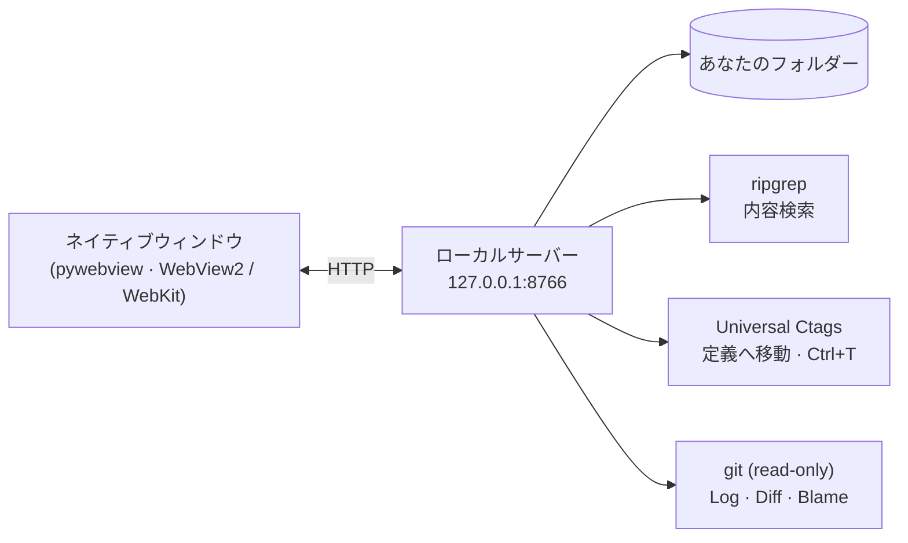

<p align="right"><a href="README.md">English</a> · <a href="README.ko.md">한국어</a> · <a href="README.zh.md">中文</a> · <b>日本語</b></p>

# ReadO

**Windows / macOS 向けの軽量なソースビューア兼エディタ。** コードを読む・移動する・すぐ直すための VS Code / IntelliJ の要点だけを搭載しました。フォルダーを開き、クラスや関数へジャンプし、テキストファイルをその場で編集できます。IDE のインストールもプロジェクト設定も不要で、完全にオフラインで動作します。

## 機能

| 分野 | 内容 |
|---|---|
| **何でも開く** | フォルダーや任意の場所のファイル：Ctrl+O、ドラッグ＆ドロップ、コマンドライン、エクスプローラーの「プログラムから開く」。2 回目の起動は実行中のウィンドウへファイルを渡します |
| **編集** | Monaco エディタ、Ctrl+S、ディスク上で変更された場合の競合確認、元のエンコード（UTF-8 / BOM / CP949 / UTF-16）と改行を保持、検索・置換、プレビュー付きの複数ファイル置換 |
| **ナビゲーション** | 定義へ移動、使用箇所の検索、シンボル検索（Ctrl+T）、アウトライン、ファイルへ移動（Ctrl+P）。コンポーネントタグと import がリンクになります（JS / TS / Vue / Java / Python / Go / C / PHP / Rust …） |
| **検索** | 内蔵 ripgrep によるファイル内容検索：大文字小文字、単語、正規表現、glob、範囲、プレビュー |
| **Git（読み取り専用）** | Local Changes、diff ウィンドウ、Log グラフ、ファイル History、Stash、Blame。リポジトリを変更するコマンドは AI エージェント向けの指示文になり、ReadO 自身は書き込みません |
| **画面** | タブと最大 4 つのエディタ分割、コマンドパレット、VS Code / IntelliJ キーマップ、ライト / ダークテーマ、セッション復元 |
| **オフライン** | Monaco、marked、フォント、ripgrep、ctags を同梱。実行時にネットワークは不要です |

## 仕組み



## ダウンロード

[Releases](../../releases) ページからお使いの環境のファイルを入手してください。Python は不要です。

| 環境 | ファイル |
|---|---|
| Windows 10/11 | `reado.exe`（単一ファイル） |
| macOS（Apple シリコン、M1 以降） | `ReadO-mac-arm64.dmg` |
| macOS（Intel） | `ReadO-mac-x86_64.dmg` |

> コード署名のないビルドです。**Windows:** 初回起動時に SmartScreen の警告が出ることがあります。*詳細情報 → 実行*を選んでください。**macOS:** dmg を開いて ReadO を Applications にドラッグし、初回は右クリック → *開く*を選びます。「壊れている」と表示された場合は `xattr -dr com.apple.quarantine /Applications/ReadO.app` を実行してください。
>
> macOS の注意: シンボルインデックスは Universal Ctags がインストールされている場合のみ使われ（`brew install universal-ctags`）、無ければ定義へ移動は検索で代替されます。「プログラムから開く」登録は Windows 専用です。

## ソースから実行

Windows または macOS と Python 3.10 以上が必要です。

```bash
pip install -r requirements.txt
python fetch-vendor.py     # once: Monaco / marked / fonts / ripgrep / ctags into vendor\
python reado.py [file ...]
```

## その他

- [全機能とショートカット](docs/REFERENCE.md)
- [変更履歴](CHANGELOG.md) · [リリース手順](docs/RELEASE.md) · [設計ドキュメント](docs/GIT-DESIGN.md)
- [コントリビュート](CONTRIBUTING.md) · [セキュリティ](SECURITY.md)

## ライセンス

MIT、[LICENSE](LICENSE) を参照。同梱ツールはそれぞれのライセンスに従います：ripgrep（MIT / Unlicense）、Universal Ctags（GPL-2.0、別プログラムとして実行、ソースは <https://github.com/universal-ctags/ctags>）、Monaco（MIT）、marked（MIT）、Pretendard / D2Coding（OFL）。第三者の表記は [NOTICE](NOTICE) を参照。
