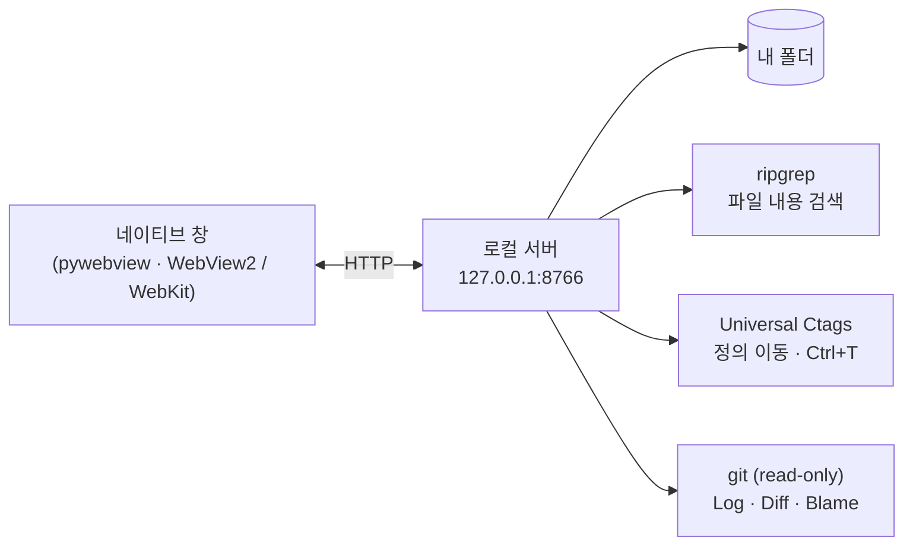

<p align="right"><a href="README.md">English</a> · <b>한국어</b> · <a href="README.zh.md">中文</a> · <a href="README.ja.md">日本語</a></p>

# ReadO

**Windows·macOS용 가벼운 소스 뷰어·에디터.** 코드를 읽고, 이동하고, 바로 고치는 VS Code / IntelliJ의 핵심만 담았습니다. 폴더를 열고 클래스·함수로 점프하고 텍스트 파일을 그 자리에서 수정합니다. IDE 설치도 프로젝트 설정도 필요 없고 완전히 오프라인으로 동작합니다.

## 기능

| 영역 | 내용 |
|---|---|
| **무엇이든 열기** | 폴더 또는 어디에 있든 파일: Ctrl+O, 드래그 앤 드롭, 명령줄, 탐색기 "연결 프로그램". 두 번째 실행은 파일을 실행 중인 창으로 넘깁니다 |
| **편집** | Monaco 에디터, Ctrl+S, 디스크에서 파일이 바뀌면 충돌 확인, 원래 인코딩(UTF-8 / BOM / CP949 / UTF-16)과 줄바꿈 유지, 찾기·바꾸기, 미리보기가 있는 여러 파일 바꾸기 |
| **탐색** | 정의로 이동, 사용처 찾기, 심볼 검색(Ctrl+T), 아웃라인, 파일로 이동(Ctrl+P). 컴포넌트 태그와 import가 링크 (JS / TS / Vue / Java / Python / Go / C / PHP / Rust …) |
| **검색** | 내장 ripgrep 으로 파일 내용 검색: 대소문자, 단어, 정규식, glob, 범위, 미리보기 |
| **Git (읽기 전용)** | Local Changes, diff 창, Log 그래프, 파일 History, Stash, Blame. 저장소를 바꾸는 명령은 AI 에이전트에게 줄 지시문으로 바뀌며 ReadO 는 쓰지 않습니다 |
| **화면** | 탭과 최대 4개 에디터 분할, 명령 팔레트, VS Code / IntelliJ 단축키, 라이트·다크 테마, 세션 복원 |
| **오프라인** | Monaco, marked, 글꼴, ripgrep, ctags 를 내장. 실행 중 네트워크가 필요 없습니다 |

## 동작 방식



## 다운로드

[Releases](../../releases) 페이지에서 사용하는 시스템에 맞는 파일을 받으세요. Python 이 필요 없습니다.

| 시스템 | 파일 |
|---|---|
| Windows 10/11 | `reado.exe` (파일 하나) |
| macOS, Apple Silicon (M1 이상) | `ReadO-mac-arm64.dmg` |
| macOS, Intel | `ReadO-mac-x86_64.dmg` |

> 코드 서명이 없는 빌드입니다. **Windows:** 처음 실행할 때 SmartScreen 경고가 뜰 수 있습니다. *추가 정보 → 실행*을 누르세요. **macOS:** dmg 를 열어 ReadO 를 Applications 로 끌어 놓고, 처음에는 우클릭 → *열기*를 선택하세요. "손상되었다"고 나오면 `xattr -dr com.apple.quarantine /Applications/ReadO.app` 을 실행합니다.
>
> macOS 참고: 심볼 인덱스는 Universal Ctags 가 설치된 경우에만 쓰이고(`brew install universal-ctags`), 없으면 정의 이동이 검색으로 대체됩니다. "연결 프로그램" 등록은 Windows 전용입니다.

## 소스에서 실행

Windows 또는 macOS 와 Python 3.10 이상이 필요합니다.

```bash
pip install -r requirements.txt
python fetch-vendor.py     # once: Monaco / marked / fonts / ripgrep / ctags into vendor\
python reado.py [file ...]
```

## 더 보기

- [전체 기능과 단축키](docs/REFERENCE.md)
- [변경 내역](CHANGELOG.md) · [릴리스 절차](docs/RELEASE.md) · [설계 문서](docs/GIT-DESIGN.md)
- [기여 안내](CONTRIBUTING.md) · [보안](SECURITY.md)

## 라이선스

MIT, [LICENSE](LICENSE) 참고. 내장 도구는 각자의 라이선스를 따릅니다: ripgrep (MIT / Unlicense), Universal Ctags (GPL-2.0, 별도 프로그램으로 실행, 소스 <https://github.com/universal-ctags/ctags>), Monaco (MIT), marked (MIT), Pretendard / D2Coding (OFL). 제3자 고지: [NOTICE](NOTICE).
