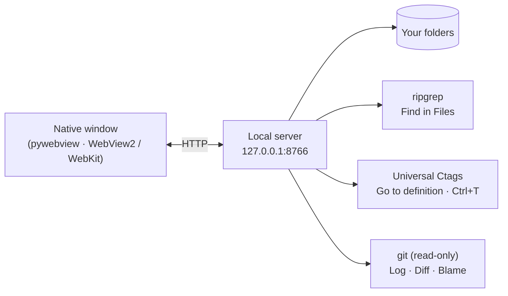

<p align="right"><b>English</b> · <a href="README.ko.md">한국어</a> · <a href="README.zh.md">中文</a> · <a href="README.ja.md">日本語</a></p>

# ReadO

**A lightweight desktop source viewer and editor for Windows and macOS.** The essentials of VS Code / IntelliJ for reading, navigating and quickly editing code: open any folder, jump to classes and functions, edit text files in place. No IDE install, no project setup, works fully offline.

## Features

| Area | What you get |
|---|---|
| **Open anything** | A folder or single files from anywhere: Ctrl+O, drag and drop, command line, Explorer "Open with". A second launch hands its files to the running window |
| **Editing** | Monaco editor, Ctrl+S, conflict check when a file changes on disk, original encoding (UTF-8 / BOM / CP949 / UTF-16) and line endings kept, find / replace, replace in files with preview |
| **Navigation** | Go to definition, find usages, symbol search (Ctrl+T), outline, Go to File (Ctrl+P); component tags and imports are links (JS / TS / Vue / Java / Python / Go / C / PHP / Rust …) |
| **Search** | Find in Files with bundled ripgrep: case, whole word, regex, globs, scope, preview |
| **Git (read-only)** | Local Changes, diff windows, Log graph, file History, Stash, Blame. Commands that change a repository become an instruction for an AI agent instead; ReadO never writes |
| **Layout** | Tabs and up to 4 editor panes, command palette, VS Code or IntelliJ keymap, light / dark theme, session restore |
| **Offline** | Monaco, marked, fonts, ripgrep and ctags are bundled; no network at run time |

## How it works



## Download

Get the file for your system from the [Releases](../../releases) page. No Python needed.

| System | File |
|---|---|
| Windows 10/11 | `reado.exe` (one file) |
| macOS, Apple Silicon (M1 and later) | `ReadO-mac-arm64.dmg` |
| macOS, Intel | `ReadO-mac-x86_64.dmg` |

> The builds are not code-signed. **Windows:** SmartScreen may warn on first start: choose *More info → Run anyway*. **macOS:** open the dmg, drag ReadO to Applications, then right-click it → *Open* the first time. If macOS says the app is damaged, run `xattr -dr com.apple.quarantine /Applications/ReadO.app`.
>
> macOS notes: the symbol index uses Universal Ctags only if it is installed (`brew install universal-ctags`); otherwise go to definition falls back to search. The "Open with" registration is Windows-only.

## Run from source

Requires Windows or macOS and Python 3.10+.

```bash
pip install -r requirements.txt
python fetch-vendor.py     # once: Monaco / marked / fonts / ripgrep / ctags into vendor\
python reado.py [file ...]
```

## More

- [Full feature list and shortcuts](docs/REFERENCE.md)
- [Changelog](CHANGELOG.md) · [Release steps](docs/RELEASE.md) · [Design notes](docs/GIT-DESIGN.md)
- [Contributing](CONTRIBUTING.md) · [Security](SECURITY.md)

## License

MIT, see [LICENSE](LICENSE). Bundled tools keep their own licenses: ripgrep (MIT / Unlicense), Universal Ctags (GPL-2.0, run as a separate program; source at <https://github.com/universal-ctags/ctags>), Monaco (MIT), marked (MIT), Pretendard / D2Coding (OFL). Third-party notices: [NOTICE](NOTICE).
