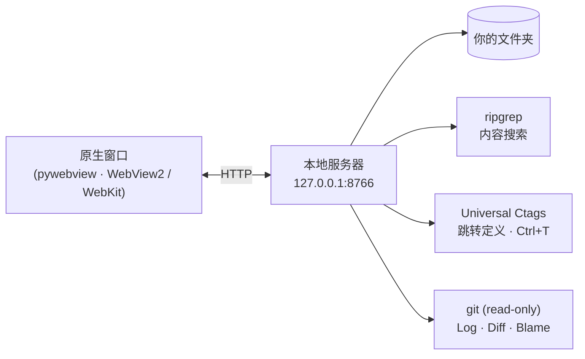

<p align="right"><a href="README.md">English</a> · <a href="README.ko.md">한국어</a> · <b>中文</b> · <a href="README.ja.md">日本語</a></p>

# ReadO

**适用于 Windows 和 macOS 的轻量级源码查看与编辑器。** 保留 VS Code / IntelliJ 中阅读、跳转、快速修改代码所需的核心功能：打开任意文件夹，跳转到类和函数，就地编辑文本文件。无需安装 IDE，无需配置项目，完全离线运行。

## 功能

| 方面 | 内容 |
|---|---|
| **打开任何内容** | 文件夹或任意位置的文件：Ctrl+O、拖放、命令行、资源管理器“打开方式”。再次启动会把文件交给已运行的窗口 |
| **编辑** | Monaco 编辑器、Ctrl+S、磁盘上文件被修改时的冲突检查、保留原编码（UTF-8 / BOM / CP949 / UTF-16）和换行符、查找替换、带预览的多文件替换 |
| **导航** | 跳转到定义、查找引用、符号搜索（Ctrl+T）、大纲、转到文件（Ctrl+P）；组件标签和 import 可点击跳转（JS / TS / Vue / Java / Python / Go / C / PHP / Rust …） |
| **搜索** | 内置 ripgrep 的文件内容搜索：大小写、整词、正则、glob、范围、预览 |
| **Git（只读）** | Local Changes、diff 窗口、Log 图、文件 History、Stash、Blame。会修改仓库的命令会变成给 AI 代理的指令，ReadO 本身从不写入 |
| **界面** | 标签页和最多 4 个编辑器分栏、命令面板、VS Code / IntelliJ 快捷键、浅色 / 深色主题、会话恢复 |
| **离线** | 内置 Monaco、marked、字体、ripgrep 和 ctags，运行时不需要网络 |

## 工作原理



## 下载

从 [Releases](../../releases) 页面下载适合你系统的文件，不需要 Python。

| 系统 | 文件 |
|---|---|
| Windows 10/11 | `reado.exe`（单个文件） |
| macOS，Apple 芯片（M1 及以后） | `ReadO-mac-arm64.dmg` |
| macOS，Intel | `ReadO-mac-x86_64.dmg` |

> 这些构建没有代码签名。**Windows：** 首次运行时 SmartScreen 可能会警告，请选择*更多信息 → 仍要运行*。**macOS：** 打开 dmg，把 ReadO 拖到 Applications，首次请右键 → *打开*。如果提示“已损坏”，请运行 `xattr -dr com.apple.quarantine /Applications/ReadO.app`。
>
> macOS 说明：只有安装了 Universal Ctags（`brew install universal-ctags`）才会使用符号索引，否则跳转定义会退回到搜索。“打开方式”注册仅限 Windows。

## 从源码运行

需要 Windows 或 macOS，以及 Python 3.10 或更高版本。

```bash
pip install -r requirements.txt
python fetch-vendor.py     # once: Monaco / marked / fonts / ripgrep / ctags into vendor\
python reado.py [file ...]
```

## 更多

- [完整功能与快捷键](docs/REFERENCE.md)
- [更新日志](CHANGELOG.md) · [发布步骤](docs/RELEASE.md) · [设计文档](docs/GIT-DESIGN.md)
- [参与贡献](CONTRIBUTING.md) · [安全](SECURITY.md)

## 许可证

MIT，见 [LICENSE](LICENSE)。内置工具遵循各自的许可证：ripgrep（MIT / Unlicense）、Universal Ctags（GPL-2.0，作为独立程序运行，源码见 <https://github.com/universal-ctags/ctags>）、Monaco（MIT）、marked（MIT）、Pretendard / D2Coding（OFL）。第三方声明见 [NOTICE](NOTICE)。
